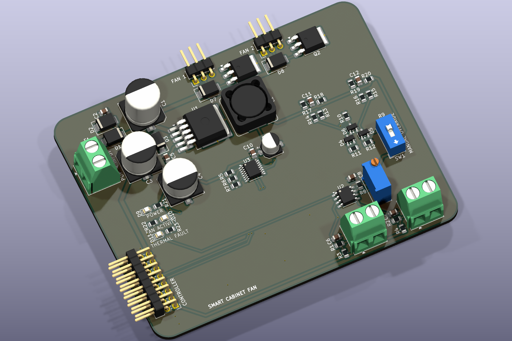
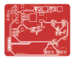

# Smart Cabinet Fan Controller - Visual Guide

These are CAD exports, not photographs of assembled hardware. The views were generated from the source files in this folder using KiCad 9.0.9.

*3D CAD render. Components without an assigned or available model are omitted; use the schematic and layout for the complete design.*

| Visual | Description |
| --- | --- |
| [3D CAD render](images/pcb-3d-render.png) | Angled top view using the models available to KiCad; a visualization of the unbuilt design. |
| [Front PCB layout](images/pcb-front.svg) | Front copper, front silkscreen, and board outline; viewed from the top. |
| [Back PCB layout](images/pcb-back.svg) | Back copper, back silkscreen, and outline; mirrored to show the underside. |
| [Schematic overview](images/schematic-overview.png) | First sheet of the schematic; use the PDF for all sheets and readable detail. |
| [Complete schematic](../exports/schematic.pdf) | All hierarchical schematic sheets in their source order. |

Board layouts depict the stored routing and copper fills. They do not establish electrical correctness or fabrication readiness.

*Front copper, front silkscreen, and board outline.*

*Back copper and silkscreen, mirrored to show the underside.*
